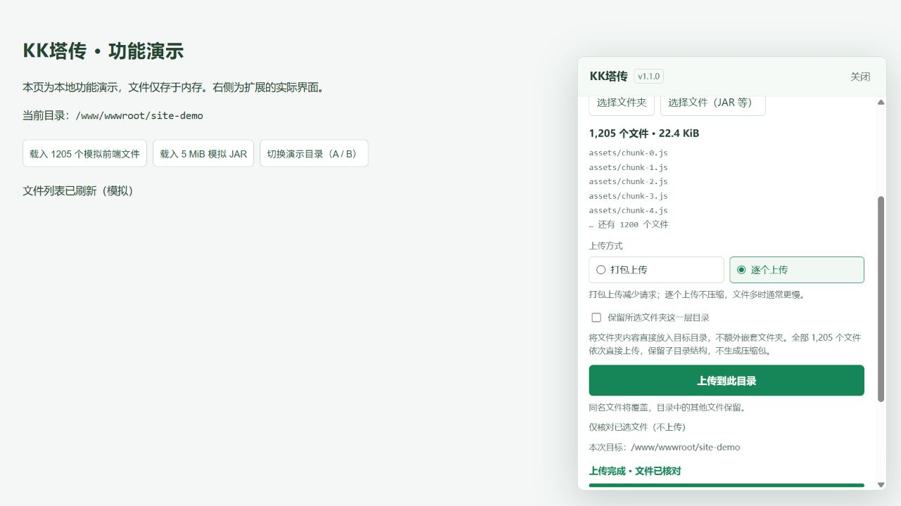

# KK塔传 · KK宝塔文件上传助手

KK塔传是一款 Chrome 扩展。在已登录的宝塔文件管理页面选择文件夹或文件，即可上传到已验证的服务器目录。无需 SSH 或另配面板 API 密钥。

当前版本：**1.1.0**。支持 Chrome 120 及以上；Linux 宝塔面板直接访问入口开放的版本为 **9.3.0、9.4.0、9.5.0、9.6.0、11.0.0、11.1.0、11.2.0、11.3.0、11.4.0、11.4.1、11.5.0、11.6.0、11.7.0、11.8.0、11.8.1、13.0.0、13.1.0**。其他版本、Windows 面板和代理管理入口暂不支持。KK塔传是独立第三方工具，与宝塔官方没有隶属关系。



## 安装或升级

1. 下载项目源码（GitHub 仓库页面的 **Code → Download ZIP**）或单独提供的 `kk-tachuan-1.1.0.zip`，解压到一个固定文件夹。该文件夹内应直接包含 `manifest.json`。
2. Chrome 地址栏打开 `chrome://extensions`，开启右上角“开发者模式”。
3. 点击“加载已解压的扩展程序”（部分版本称“加载未打包的扩展程序”），选择上述文件夹。
4. 在 Chrome 扩展菜单中固定“KK塔传 · KK宝塔文件上传助手”。

保留解压后的文件夹，Chrome 会从这里读取扩展。升级时先等待上传结束，再替换扩展文件并点击“重新加载”，然后刷新宝塔页面。不要在任务进行中重载扩展或刷新页面。

## 上传

1. 正常登录支持的宝塔面板，进入文件管理中的目标目录。
2. 点击 Chrome 工具栏中的KK塔传图标，查看服务器地址和完整目标路径。可以手工修改路径，再点击“验证目录”；验证通过才能上传。
3. 选择构建后的文件夹（例如 `dist`），或直接选择 JAR 等文件。
4. 文件夹可选择“打包上传”或“逐个上传”，然后点击“上传到此目录”。写入前会只读检查目录与文件核对接口，检查失败即停止。
5. 等待“上传完成 · 文件已核对”。整批核对通过后会播放一次短暂的彩纸撒花，遵循系统的“减少动态效果”设置。

**默认上传所选文件夹的内容，不额外嵌套所选文件夹。** 例如选择 `dist`，目标为 `/www/wwwroot/site`，最终是 `/www/wwwroot/site/index.html` 和 `/www/wwwroot/site/assets/...`。勾选“保留所选文件夹这一层目录”才会增加 `dist/`。

| 方式 | 行为 |
| --- | --- |
| 打包上传（默认） | 纯英文等 ASCII 路径打成 ZIP 后上传、解压；中文等非 ASCII 路径直接上传，避免解压时名称乱码。 |
| 逐个上传 | 所有文件依次直接上传，自动创建所需子目录，不生成 ZIP。文件多时通常更慢。 |
| 直接选择文件 | 按原文件名分片上传，不自动解压；适合 JAR 等文件。 |

同名文件会被覆盖，其他远程文件保留。上传后不自动删除旧资源、备份、回滚或启动/重启 Java 等服务。取消仅停止后续操作，不撤销已完成的写入；服务器解压期间无法通过取消按钮中止。上传过程中保持本页打开。

插件空闲时会自动跟随宝塔当前目录，切换文件夹后重新验证目标路径，已经选择的本地文件保留。手动修改目标路径后，会固定使用手动目录；点击“跟随当前目录”可恢复自动跟随。

上传或核对开始后，本次目标目录固定，切换宝塔目录不会影响正在进行的任务。任务结束后再跟随当前页面目录；结果区的“本次目标”仍显示该次任务实际使用的目录。

不同服务器的页面可以分别操作；同一服务器建议按顺序上传，尤其不要同时向同一目录写入。KK塔传没有跨窗口任务锁，面板解压过程也可能共用日志。

## 核对与问题处理

“已核对”表示**全部选定文件的完整路径存在、是普通文件且字节数相同**，不是内容散列比对或站点运行检查。同名同大小的旧文件也可能通过此项核对。失败或中断不会显示整批完成。

- **仅核对已选文件**：重新选择原文件夹并验证目标目录后，可检查服务器现有文件，不写入文件。
- **仅补传中文等特殊名称文件**：打包模式下出现此按钮时，可只上传这些文件，再核对全部清单。此前的乱码文件不会自动删除。
- **复制诊断信息**：手动复制版本、主机名、目录、文件数量、错误和核对摘要；问题详情最多列出 20 个文件。发送给他人前可自行隐藏主机名和目录。诊断不包含密码、Cookie、API 密钥或登录令牌。

遇到目录验证失败、登录过期、权限不足、磁盘空间不足或面板保护拦截时，请先处理面板反馈，再继续上传。

## 使用范围

- 文件夹单次最多 60,000 个文件、原始大小最多 512 MiB；打包模式生成的 ZIP 最多 400 MiB。
- 分片大小为 2 MiB。直接选择单文件不受文件夹总大小上限约束，仍受服务器限制。
- 空目录、Linux 权限和符号链接语义不会随浏览器文件夹选择保留。
- 中断或失败时，打包暂存目录可能保留；路径会在日志/诊断中显示。成功后只清理本次随机暂存目录。
- 面板接口随版本变化，仅开放上面列出的具体版本。新增版本已比对官方更新包并通过本地模拟，尚未逐一在真实服务器验证；首次使用请在独立目录检查。

具体行为见 [兼容性说明](docs/compatibility.md)，数据处理见 [隐私政策](PRIVACY.md)。

## 权限与第三方代码

只申请 `activeTab` 和 `scripting`：点击图标后，在当前页面显示上传界面并复用面板的有效会话。不申请全部网站、Cookie、历史记录或持久存储权限。文件直接发送到当前面板服务器，没有第三方中转、统计或运行时远程代码。

成功动效采用本地随包提供的 [canvas-confetti 1.9.4](https://github.com/catdad/canvas-confetti)，ISC 许可证保存在 `vendor/canvas-confetti.LICENSE.txt`。

## 开发与反馈

项目无需构建步骤即可加载。运行自动化检查需要 Node.js 24：

```sh
node --test tests/core.test.cjs tests/extension.test.cjs tests/ui.test.cjs tests/runtime.test.cjs tests/celebration.test.cjs
```

兼容性对照脚本会读取宝塔官方下载包；本仓库不包含宝塔面板源码或更新压缩包。遇到问题可在 [GitHub Issues](https://github.com/huangkunkun/kk-tachuan/issues) 反馈；分享诊断信息前请检查其中的主机名、目录和文件名。

项目自身代码采用 [MIT 许可证](LICENSE)，随附的第三方代码遵循各自的许可证。
